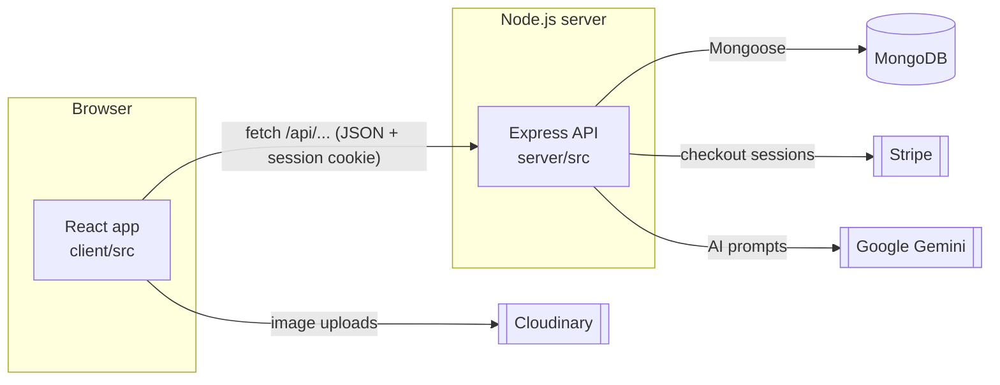
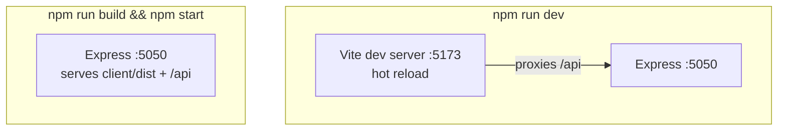
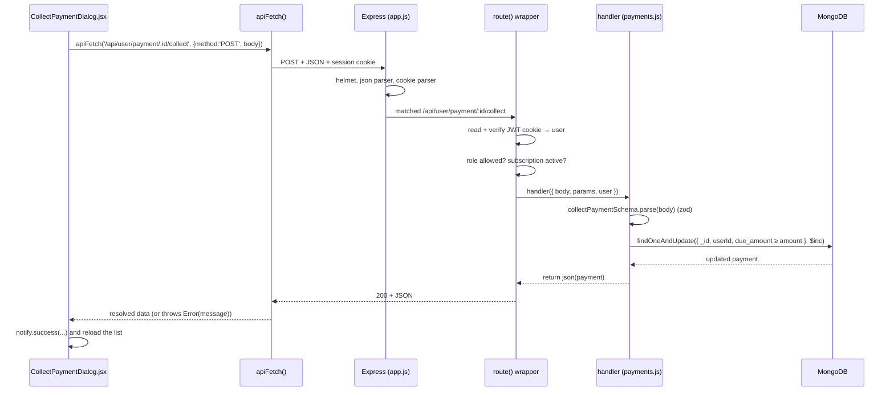

# Architecture

## The big picture



This is the **MERN** stack:

| Letter | Technology  | Role here                                                       |
| ------ | ----------- | --------------------------------------------------------------- |
| M      | **MongoDB** | Stores every record. Accessed through **Mongoose** models.      |
| E      | **Express** | The HTTP API: routing, auth, validation, business rules.        |
| R      | **React**   | The user interface, built with **Vite**, **MUI** and **Redux**. |
| N      | **Node.js** | Runs Express (and the build tools).                             |

## One repository, three packages

The repo is an **npm workspace**: one `npm install` at the root installs everything, and
the packages can depend on each other.

```
package.json          workspaces: client, server, shared; scripts that run both
client/               React app            → package "stockflow-client"
server/               Express API          → package "stockflow-server"
shared/               plans.js             → package "@stockflow/shared"
```

`shared/plans.js` holds the subscription prices. The pricing page shows them and the
checkout API charges them, so they must never disagree; putting them in one shared package
guarantees that.

## Development vs. production



- **Development:** Vite serves the React code with instant reload and forwards every
  `/api` request to Express (see `client/vite.config.js`). The browser only ever talks to
  one origin, so the session cookie just works.
- **Production:** `npm run build` compiles the React app into `client/dist`. Express serves
  those files and the API from the same port (see the end of `server/src/app.js`).

## Life of a request

What happens when you click **Collect payment** on the Receivables page:



Every endpoint follows this exact shape, so once you understand this diagram you can read
any route in the project.

## Where things live

### Server (`server/src`)

```
index.js              Start: check config, connect to MongoDB, listen
app.js                Build the Express app: middleware, routers, static files
config.js             Every environment variable, read and checked in one place
lib/
  api.js              route() wrapper, json(), HttpError, ownedBy(), error → JSON mapping
  auth.js             Password check, JWT session cookie
  validators.js       zod schemas for every request body
  stock.js            changeStock(): the only code that changes stock
  invoices.js         Invoice approval and deletion
  db.js, stripe.js, ai.js, dates.js
models/               Mongoose schemas (one file per collection)
routes/
  auth.js             /api/auth/*, /api/register
  admin.js            /api/admin/*
  ai.js               /api/ai
  user/               /api/user/* split by business area
```

### Client (`client/src`)

```
main.jsx              Entry point: router + providers + <App/>
app/
  App.jsx             Route tree and the dashboard layout
  routes.jsx          Every page and its URL (lazy-loaded)
  navigation.js       Sidebar menus for each role
  Providers.jsx       Theme, session, Redux store, notifications
  theme.js            MUI theme
components/
  common/             Reusable building blocks: DataTable, CrudPage, PageHeader, ...
  layout/             DashboardShell (sidebar + top bar), BrandLogo
features/             One folder per business area; each page is a component
  catalog/ customers/ purchases/ sales/ receivables/ inventory/ reports/
  dashboard/ billing/ account/ auth/ admin/ ai/ home/
hooks/useApi.js       Load data from the API in a component
lib/                  apiFetch, session, formatting, printing, uploads
store/                Redux store and slices for the master data lists
```

The **feature folder** layout means everything about, say, receivables (page, dialogs) sits
together. When you add a module, you add a folder.

## Design decisions worth knowing

| Decision                                            | Why                                                                                     |
| --------------------------------------------------- | --------------------------------------------------------------------------------------- |
| Session in an **httpOnly cookie**, not localStorage | JavaScript (including injected scripts) cannot read it. See [Security](07-security.md). |
| One `route()` wrapper for every handler             | Auth, permissions and error handling cannot be forgotten on a new endpoint.             |
| **zod** schemas for request bodies                  | Bad input is rejected with a clear message before touching the database.                |
| Atomic `findOneAndUpdate` with conditions           | Two clicks or two users at once cannot double-count stock or money.                     |
| Stock changes only through `changeStock()`          | Every change lands in the stock ledger; nothing can bypass it.                          |
| Prices only on the server                           | The browser can show prices but never choose what is charged.                           |
| In-memory MongoDB for tests                         | Tests are fast, isolated and need no setup.                                             |
