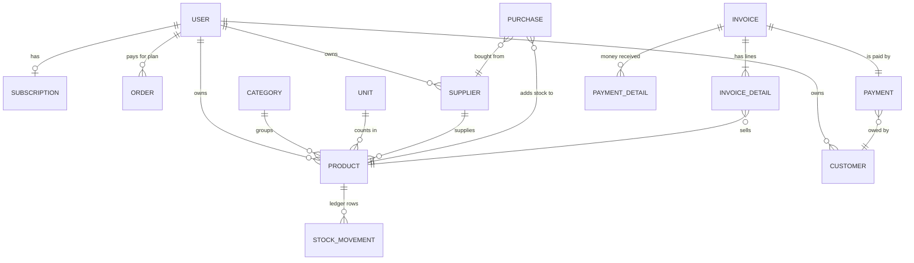

# Data model

MongoDB stores documents in collections. Each Mongoose model in `server/src/models` defines
one collection. Fields ending in `_id` or `Id` reference another collection, and
`.populate()` replaces the id with the referenced document when reading.

## Relationships

Every collection except `users`, `subscriptions` and `orders` also has `userId`: the shop
that owns the record (left out of the diagram to keep it readable).

## Collections

### `users` – `User`

| Field            | Type   | Notes                                         |
| ---------------- | ------ | --------------------------------------------- |
| `name`           | String | 3–20 characters                               |
| `username`       | String | generated from the email at sign-up           |
| `email`          | String | unique, lower-case; used to log in            |
| `password`       | String | bcrypt hash, `select: false` (never returned) |
| `role`           | String | `user` (a shop) or `admin` (the platform)     |
| `phone`, `image` | String | optional profile fields                       |

### `subscriptions` – `Subscription`

One per shop. `endDate` in the future = active. Extended by each Stripe payment.

### `orders` – `Order`

One per Stripe payment. `transactionId` is **unique**, so the same checkout can never be
redeemed twice.

### Master data: `categories`, `units`, `suppliers`, `customers`, `products`

| Model      | Main fields                                                                                       |
| ---------- | ------------------------------------------------------------------------------------------------- |
| `Category` | `name`                                                                                            |
| `Unit`     | `name` (kg, box, …)                                                                               |
| `Supplier` | `name`, `email` (unique per shop), `phone`, `address`                                             |
| `Customer` | `name`, `email` (unique per shop), `mobileNumber`, `address`, `image`                             |
| `Product`  | `productName`, `quantity` (≥ 0), `reorderLevel`, `supplierNameId`, `unitNameId`, `categoryNameId` |

`Product.quantity` is **never set directly** by the API; it only changes through
`changeStock()` (see the ledger below).

### `purchases` – `Purchase`

One row per product bought. `status: false` = pending, `true` = approved (stock added).
Fields: `purchase_no`, `date`, `supplier_id`, `category_id`, `product_id`, `buying_qty`,
`unit_price`, `buying_price` (total), `description`.

### Sales: `invoices`, `invoicedetails`, `payments`, `paymentdetails`

An invoice is spread over four collections:

| Model           | One per…       | Holds                                                                                        |
| --------------- | -------------- | -------------------------------------------------------------------------------------------- |
| `Invoice`       | invoice        | `invoice_no`, `date`, `description`, `status` (approved?)                                    |
| `InvoiceDetail` | line item      | `product_id`, `selling_qty`, `unit_price`, `selling_price`                                   |
| `Payment`       | invoice        | `customer_id`, `total_amount`, `paid_amount`, `due_amount`, `discount_amount`, `paid_status` |
| `PaymentDetail` | money received | `current_paid_amount`, `date`                                                                |

`paid_status` is one of `full_paid`, `partial_paid`, `full_due`.

### `stockmovements` – `StockMovement` (the stock ledger)

| Field        | Notes                                                         |
| ------------ | ------------------------------------------------------------- |
| `product_id` | which product                                                 |
| `type`       | `purchase`, `sale`, `adjustment` or `reversal`                |
| `quantity`   | signed change: `+40`, `-5`                                    |
| `balance`    | product quantity right after this change                      |
| `reference`  | the purchase or invoice that caused it (none for adjustments) |
| `note`       | e.g. `Invoice INV-20261105-1A2B3C`, `Damaged: dropped pallet` |

Rows are only ever inserted, never edited (the one exception: rolling back a failed invoice
approval). Deleting an approved purchase or invoice does not remove its row either; it adds
a `reversal` row that undoes it, so the history stays complete.

## Odd names, explained

Some names come from the original project and are kept so existing databases keep working:

- Model `Purchases` → collection `purchases`; model `Invoicedetails` → `invoicedetails`.
- Product references are called `supplierNameId`, `unitNameId`, `categoryNameId` even though
  they hold ids, not names.
- Both snake_case (`invoice_id`) and camelCase (`userId`) appear.

Renaming them would need a data migration; it is listed in [next steps](11-next-steps.md).

## Indexes

- Every `userId` is indexed, because nearly every query filters by it.
- `users.email` is unique; `customers` and `suppliers` have a unique `(userId, email)`
  index, so two shops can have the same customer email.
- `orders.transactionId` is unique.
- `invoice_id` on detail, payment and payment-detail collections; `product_id` and
  `reference` on stock movements.

`server/scripts/migrate-assign-owner.mjs` upgrades a database created before records had
owners (see the main README).
