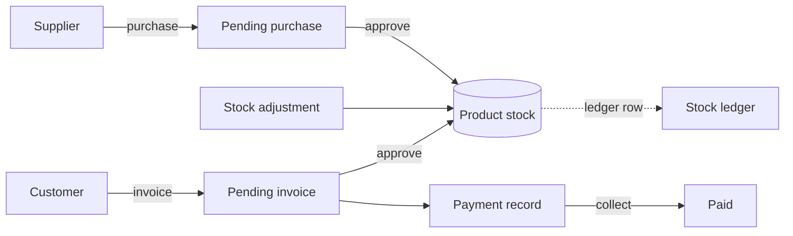
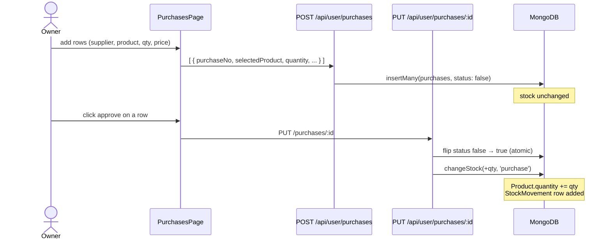
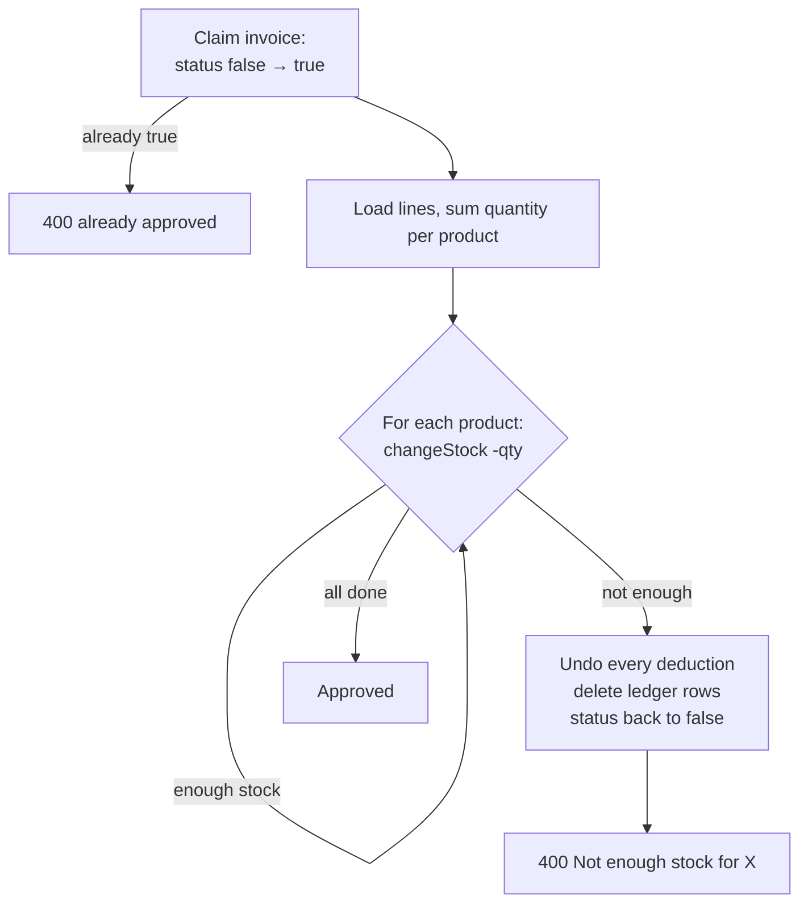
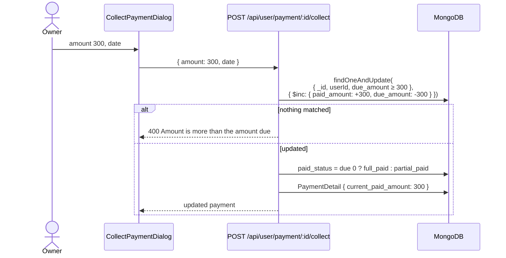
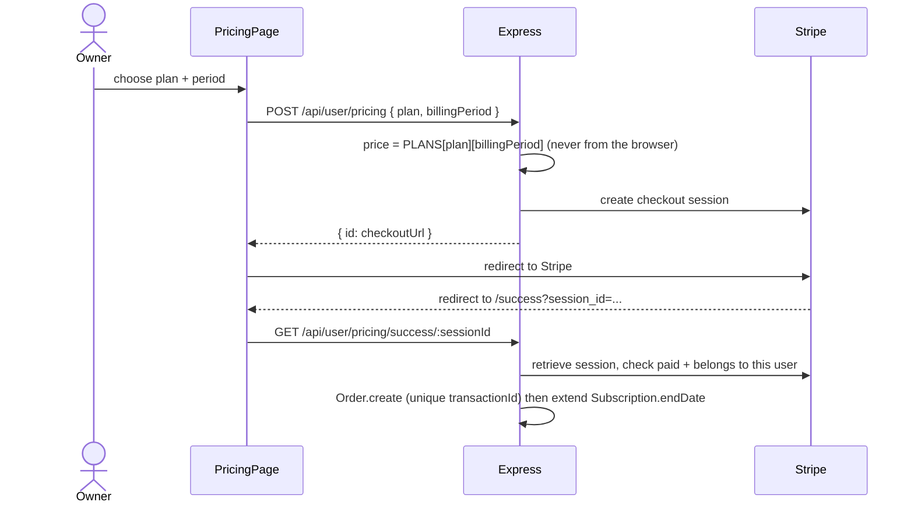

# Business flows

How the main ERP processes move through the system, with the code that runs at each step.

## Overview



## 1. Set up master data

Before trading, a shop creates categories, units, suppliers, customers and products
(`CrudPage` screens, `routes/user/catalog.js`). A new product starts with `quantity: 0`. The
quantity can **not** be typed in: it only changes through the flows below.

## 2. Buy stock (purchasing)



Code: `server/src/routes/user/purchases.js`, `server/src/lib/stock.js`.

## 3. Sell (invoicing)

Creating an invoice (`POST /api/user/invoice`) writes four kinds of document at once:

1. `Invoice` with `status: false` and a generated number like `INV-20261105-1A2B3C`
2. one `InvoiceDetail` per line
3. one `Payment` with total, paid, due and status
4. one `PaymentDetail` for the amount paid upfront

If any of these fails, the ones already written are deleted (`deleteInvoiceRecords`), so a
half-created invoice is never left behind.

The customer can be existing or new (`selectedCustomer: 'new_customer'` creates one). The
server also checks every product belongs to the shop.

### Approving an invoice

`POST /api/user/invoiceapprove` → `approveInvoice()` in `server/src/lib/invoices.js`:



Either **every** product is deducted or **none** is. This is what "atomic" means for a
business operation.

### Why approvals can't run twice

Both approvals start by flipping the status with a conditional update:

```js
Invoice.findOneAndUpdate({ ...filter, status: false }, { status: true }, { new: true });
```

Only one request can match `status: false`. A second click (or a second browser tab) gets
`null` and a 400 instead of deducting stock again. `tests/inventory.test.js` checks this.

## 4. Get paid (receivables)

An invoice can be created as fully paid, partly paid or unpaid. Anything unpaid shows up on
**Receivables**. When the customer pays:



`GET /api/user/payment/:id/history` lists every amount received.

Only **approved** invoices count as receivables: a pending invoice is still a draft, so it
is not money owed yet, and the collect endpoint refuses it with "Approve the invoice before
collecting payments".

## 5. Delete an approved document (reversal)

Deleting a pending purchase or invoice simply removes it: it never touched stock. Deleting an
**approved** one must undo its effect, and in ERP terms that is done with a new, opposite
movement (a **reversal**), never by editing history:

| Deleted           | What happens                                                                                                                                                          |
| ----------------- | --------------------------------------------------------------------------------------------------------------------------------------------------------------------- |
| Approved purchase | `changeStock(-qty, 'reversal')`. Refused with 400 if that stock was already sold (stock would go negative); the purchase is restored. Use a stock adjustment instead. |
| Approved invoice  | `changeStock(+qty, 'reversal')` for each line: the goods are back on the shelf.                                                                                       |

Both delete the document **first** (`findOneAndDelete`), then reverse. Two simultaneous
deletes can therefore never both reverse the stock: the second finds nothing to delete.

## 6. Server-computed totals

The browser shows totals as you type, but the server ignores any totals it is sent. It
recomputes every line as `quantity × unitPrice`, rounds to 2 decimals (`roundMoney`), applies
the discount, and checks the paid amount is not more than the total. A tampered request
cannot sell goods for less than the prices on its own lines.

## 7. Correct stock (adjustments)

`POST /api/user/stock/adjustments` with `{ productId, quantity: -2, note: 'Damaged' }`
calls `changeStock()` with type `adjustment`. Stock can never go below zero: removing more
than is in stock returns a 400.

## 8. The stock ledger

`changeStock()` is the **only** function that changes `Product.quantity`:

```js
export async function changeStock({ productId, quantity, type, reference, note, filter = {} }) {
  const enoughStock = quantity < 0 ? { quantity: { $gte: -quantity } } : {};
  const product = await Product.findOneAndUpdate(
    { ...filter, _id: productId, ...enoughStock },
    { $inc: { quantity } },
    { new: true }
  );
  if (!product) return null;
  await StockMovement.create({ ..., quantity, balance: product.quantity, reference, note });
  return product;
}
```

Because purchases, sales, adjustments and reversals all go through it, the ledger is a complete history.
The **Stock ledger** page shows it, filterable by product.

## 9. Low stock

Set a **reorder level** on a product. `GET /api/user/stock/low` returns products where
`quantity ≤ reorderLevel` (and the level is above 0) using a MongoDB `$expr` that compares
two fields of the same document:

```js
{ reorderLevel: { $gt: 0 }, $expr: { $lte: ['$quantity', '$reorderLevel'] } }
```

## 10. Expenses

Rent, salaries, utilities and other running costs are recorded on the **Expenses** page
(`routes/user/expenses.js`). They do not affect stock. The dashboard shows this month's
total next to purchases, so you can compare money in against money out.

## 11. Dashboard KPIs

`GET /api/user/dashboard` runs about a dozen queries in parallel (`Promise.all`) and returns
everything the dashboard needs in one response. It is a good place to learn **aggregation
pipelines**, for example sales per month:

```js
Invoice.aggregate([
  { $match: { userId, status: true, date: { $gte: sixMonthsAgo } } }, // approved invoices
  { $lookup: { from: 'payments', localField: '_id', foreignField: 'invoice_id', as: 'payment' } },
  { $unwind: '$payment' }, // join their payment
  {
    $group: {
      _id: { year: { $year: '$date' }, month: { $month: '$date' } },
      total: { $sum: '$payment.total_amount' },
    },
  }, // sum per month
]);
```

Months with no sales are filled in with zero on the server so the chart has no gaps.

## 12. Subscription billing



Renewing early extends from the current end date, so no paid days are lost. The unique
`transactionId` stops the same payment being redeemed twice.
