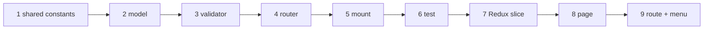

# Tutorial: add a feature end to end

This walks through how the **Expenses** module was built. Every file below exists in the
repo, so you can open it alongside. When you build your own module (say, _Supplier
payments_ or _Returns_), follow the same nine steps.

**Goal:** a shop can record running costs (rent, salaries…) and see this month's total on
the dashboard.



## Server

### 1. Shared constants – `shared/expenses.js`

The list of categories is needed by the server (to validate) and the client (to show a
dropdown), so it goes in the shared package:

```js
export const EXPENSE_CATEGORIES = [
  'Rent',
  'Salaries',
  'Utilities',
  'Transport',
  'Supplies',
  'Other',
];
```

and is exported in `shared/package.json`:

```json
"exports": { "./expenses": "./expenses.js", "./plans": "./plans.js" }
```

### 2. Model – `server/src/models/expense.js`

```js
import { EXPENSE_CATEGORIES } from '@stockflow/shared/expenses';
import { owner } from './owner.js';

const ExpenseSchema = new mongoose.Schema(
  {
    ...owner, // userId: which shop owns it
    date: { type: Date, required: true },
    category: { type: String, enum: EXPENSE_CATEGORIES, required: true },
    amount: { type: Number, required: true, min: 0 },
    paidTo: { type: String, trim: true },
    note: { type: String, trim: true },
  },
  { timestamps: true } // adds createdAt / updatedAt
);

export default mongoose.model('Expense', ExpenseSchema);
```

Then register it in `models/index.js`:

```js
export { default as Expense } from './expense.js';
```

> Always spread `...owner` into a shop's records. Forgetting it is how data leaks between
> tenants.

### 3. Validator – `server/src/lib/validators.js`

```js
export const expenseSchema = z.object({
  date, // coerced to a Date
  category: z.enum(EXPENSE_CATEGORIES),
  amount: z.coerce.number().finite().positive('must be more than 0'),
  paidTo: z.string().trim().max(100).optional(),
  note: z.string().trim().max(500).optional(),
});
```

`userId` is deliberately **not** in the schema: it always comes from the session, never
from the request body.

### 4. Router – `server/src/routes/user/expenses.js`

```js
const router = Router();

router.get(
  '/',
  route(async ({ user }) => json(await Expense.find(ownedBy(user)).sort({ date: -1 }).lean()))
);

router.post(
  '/',
  route(async ({ body, user }) => {
    const data = expenseSchema.parse(body);
    return json(await Expense.create({ ...data, userId: user._id }), 201);
  })
);

router.put(
  '/:id',
  route(async ({ body, params, user }) => {
    const data = expenseSchema.parse(body);
    const expense = await Expense.findOneAndUpdate(
      ownedBy(user, { _id: assertObjectId(params.id) }), // own records only
      data,
      { new: true, runValidators: true }
    );
    return json(found(expense, 'Expense')); // 404 if not found / not yours
  })
);

router.delete(
  '/:id',
  route(async ({ params, user }) => {
    const expense = await Expense.findOneAndDelete(
      ownedBy(user, { _id: assertObjectId(params.id) })
    );
    return json(found(expense, 'Expense'));
  })
);

export default router;
```

Notice what you did **not** have to write: login checks, subscription checks, try/catch,
status codes for bad input. `route()` handles all of it.

### 5. Mount it – `server/src/routes/user/index.js`

```js
import expenses from './expenses.js';
router.use('/expenses', expenses); // → /api/user/expenses
```

### 6. Test it – `server/tests/expenses.test.js`

```js
const ctx = useTestApp();
const rent = { date: '2026-11-01', category: 'Rent', amount: 15000, paidTo: 'Landlord' };

it('creates, lists, updates and deletes an expense', async () => {
  const { agent } = await loginAs(ctx.app);
  const { body: created } = await agent.post('/api/user/expenses').send(rent).expect(201);
  ...
});

it("hides one shop's expenses from another", async () => {
  const { agent: shopA } = await loginAs(ctx.app);
  const { agent: shopB } = await loginAs(ctx.app);
  const { body: expense } = await shopA.post('/api/user/expenses').send(rent).expect(201);
  await shopB.delete(`/api/user/expenses/${expense._id}`).expect(404);
});
```

Run `npm test`. You now have a working, tested API without having opened a browser.

**Bonus:** the dashboard total is one aggregation in `routes/user/dashboard.js`:

```js
const expensesSince = async (match, from) => {
  const [row] = await Expense.aggregate([
    { $match: { ...match, date: { $gte: from } } },
    { $group: { _id: null, total: { $sum: '$amount' } } },
  ]);
  return { total: row?.total ?? 0 };
};
```

## Client

### 7. Redux slice – `client/src/store/slices/expenseSlice.js`

```js
const { reducer, thunks } = createCrudSlice({ name: 'expenses', endpoint: '/api/user/expenses' });
export default reducer;
export { thunks };
```

and add it to the store in `store/index.js`:

```js
expenses: expenseReducer,
```

### 8. Page – `client/src/features/expenses/ExpensesPage.jsx`

Because this is plain create/read/update/delete, `CrudPage` does all the work. You only
describe the table columns and the form fields:

```jsx
const columns = [
  { label: 'Date', render: (e) => formatDate(e.date) },
  { label: 'Category', render: (e) => e.category, search: (e) => e.category },
  { label: 'Amount', align: 'right', render: (e) => formatMoney(e.amount) },
];

const fields = [
  {
    name: 'date',
    label: 'Date',
    type: 'date',
    required: true,
    fromRow: (row) => (row?.date ?? new Date().toISOString()).slice(0, 10),
  },
  {
    name: 'category',
    label: 'Category',
    type: 'select',
    required: true,
    options: EXPENSE_CATEGORIES.map((c) => ({ value: c, label: c })),
  },
  { name: 'amount', label: 'Amount', type: 'number', required: true },
];

export default function ExpensesPage() {
  return (
    <CrudPage
      title="Expenses"
      noun="expense"
      stateKey="expenses"
      thunks={thunks}
      columns={columns}
      fields={fields}
    />
  );
}
```

`fromRow` converts the stored ISO date into the `yyyy-mm-dd` format a date input expects.

For a page that is not simple CRUD (like Receivables), use `PageHeader` + `DataTable` +
`useApi` directly instead.

### 9. Route and menu

`client/src/app/routes.jsx`:

```js
{ path: 'expenses', Component: page(() => import('@/features/expenses/ExpensesPage')) },
```

`client/src/app/navigation.js`:

```js
{ label: 'Expenses', path: 'expenses', icon: Receipt },
```

Done. Run `npm run dev`, open **Purchasing → Expenses**.

## Checklist for your own feature

- [ ] Model spreads `...owner` and is exported from `models/index.js`
- [ ] zod schema for every request body; no `userId` in it
- [ ] Every query uses `ownedBy(user, …)` (or `ownedMatch` in aggregations)
- [ ] Anything that changes stock goes through `changeStock()`
- [ ] Money/stock changes use conditional atomic updates
- [ ] Tests, including a shop-isolation test
- [ ] Route in `routes.jsx`, menu entry in `navigation.js`
- [ ] Row in [API reference](08-api-reference.md)

## Exercise

Build **Supplier payments** (accounts _payable_): money you owe suppliers for approved
purchases, mirroring Receivables. You will need a `due_amount` on purchases (or a separate
model), a collect-style endpoint, and a page like `ReceivablesPage`.
